<p align="center">
  <a href="https://dabble.me/?utm_source=github&utm_medium=readme&utm_campaign=header">
    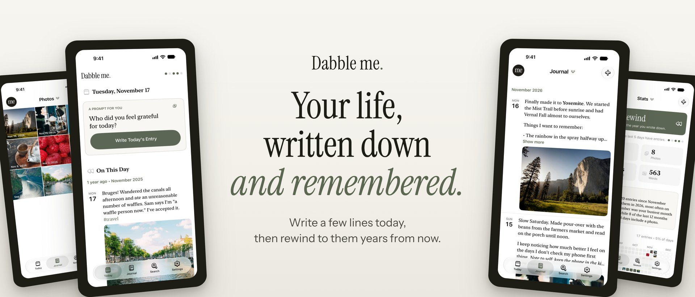
  </a>
</p>

<h1 align="center">Dabble Me</h1>

<p align="center">
  <strong>A private journal you keep by replying to an email, or in the app.</strong><br>
  Write a few lines about your day. Years from now, Dabble Me hands them back.
</p>

<p align="center">
  <a href="https://dabble.me/users/sign_up?utm_source=github&utm_medium=readme&utm_campaign=cta_top"><strong>Start journaling free →</strong></a>
  &nbsp;·&nbsp;
  <a href="https://dabble.me/journal-app?utm_source=github&utm_medium=readme&utm_campaign=cta_top">Get the iPhone &amp; iPad app</a>
  &nbsp;·&nbsp;
  <a href="https://dabble.me/subscribe?utm_source=github&utm_medium=readme&utm_campaign=cta_top">Pricing</a>
</p>

<p align="center">
  Featured in <a href="https://www.nytimes.com/wirecutter/reviews/best-journaling-apps/">Wirecutter: The Best Journaling Apps</a> · Open source (MIT) · No ads, no tracking, no social feed
</p>

---

## What Dabble Me is

Dabble Me is like a private timeline of your life. On the days and at the time you choose, it emails you "How was your day?" You reply, and your reply becomes a journal entry. Each email also brings back something you wrote before: a year ago, five years ago, on this day.

That's the whole habit. No streaks to protect and no app you have to remember to open. Write in the email, on the web, or in the iPhone and iPad app; they all write to the same journal.

- **Rewind.** On This Day shows what you wrote on today's date in past years. In winter, your year in review: your biggest month, the people and places you wrote about most, and a line of the year in your own words.
- **A few lines a day.** Up to 8 photos per entry, #hashtags, simple formatting, and songs from Spotify.
- **Find anything.** Search every word you've written, browse by calendar, and see your writing stats by year.
- **Bring your old journal.** Import from [OhLife](https://dabble.me/ohlife-alternative?utm_source=github&utm_medium=readme&utm_campaign=body), [Day One](https://dabble.me/day-one-alternative?utm_source=github&utm_medium=readme&utm_campaign=body), Ahhlife and Trailmix.
- **Ask AI about your journal, if you want to.** Connect [Claude or ChatGPT](https://dabble.me/mcp-server?utm_source=github&utm_medium=readme&utm_campaign=body) and ask "What made me happiest this year?" You approve access, and you can revoke it any time. Nothing runs until you connect.
- **Private by design.** Your journal is yours alone. Lock the app with Face ID. The app's reflections, prompts and hashtag suggestions run on your device with Apple Intelligence, so your entries aren't sent anywhere for them. Export everything, any time.

> "Dabble Me is my favorite app, bar none. It's a treasure trove of memories at this point."
> **Cassidy Williams**

> "The pro version of Dabble Me is ~$3 a month, and it is worth so much more than that."
> **Paul Graham**, co-founder of Y Combinator

## Screenshots

### On the web

<p align="center">
  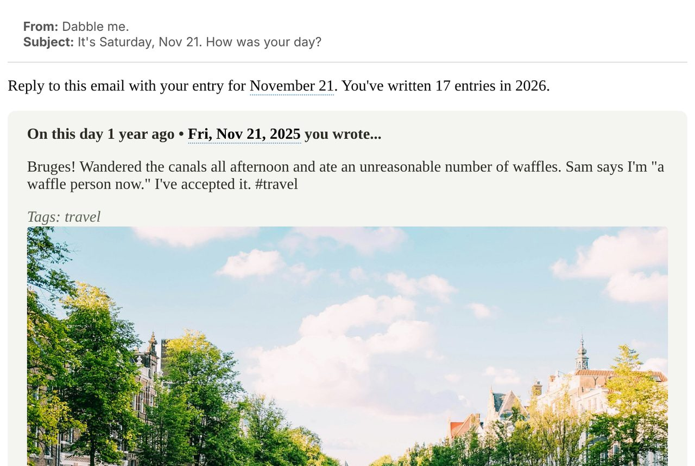
  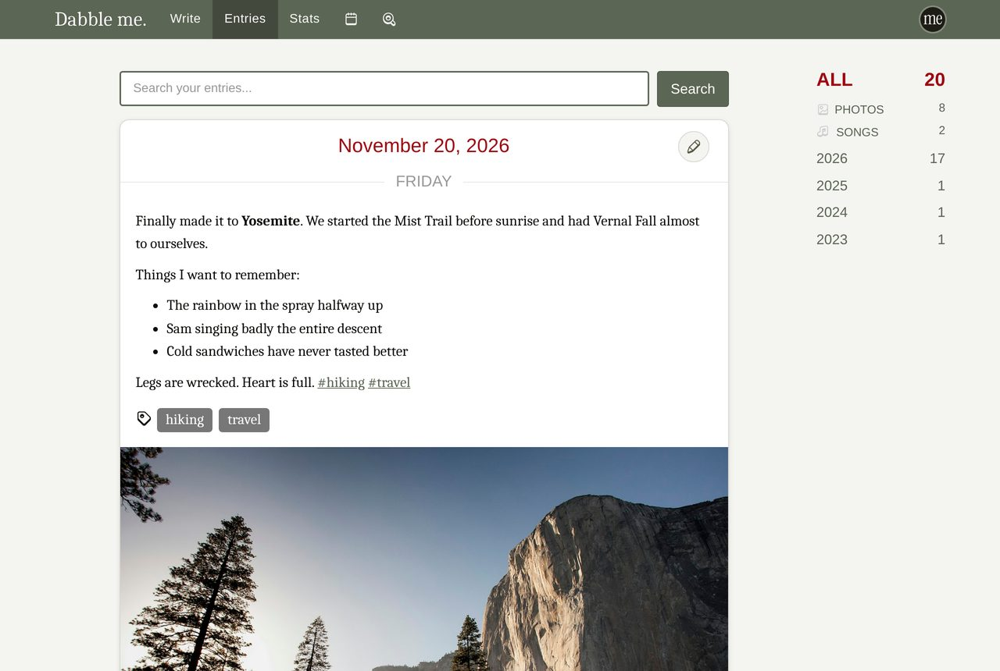
</p>
<p align="center">
  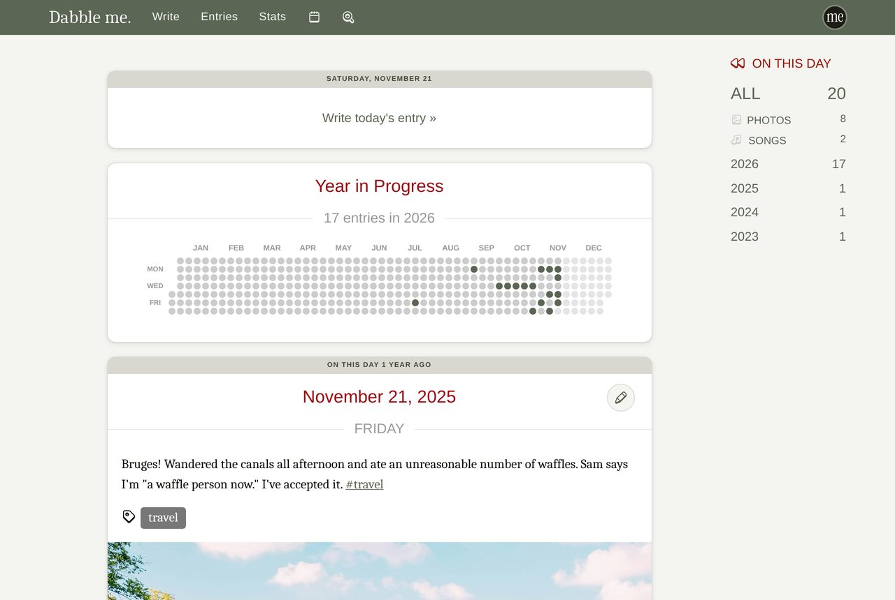
  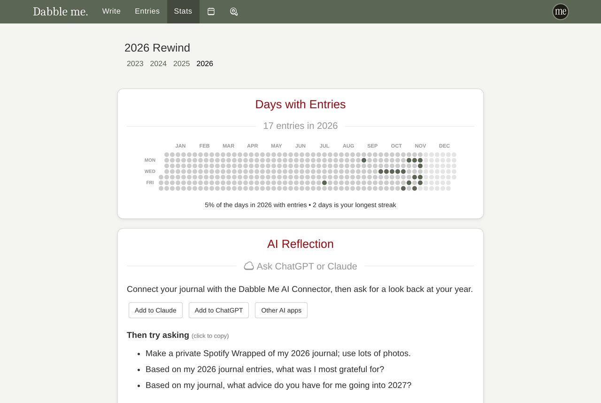
</p>

### On iPhone and iPad

<p align="center">
  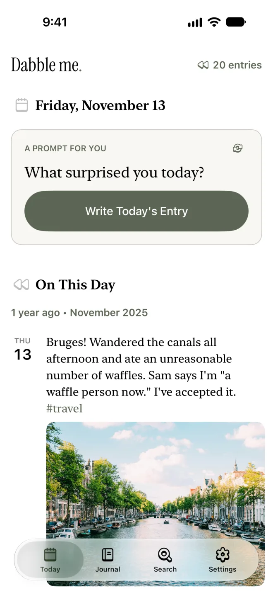
  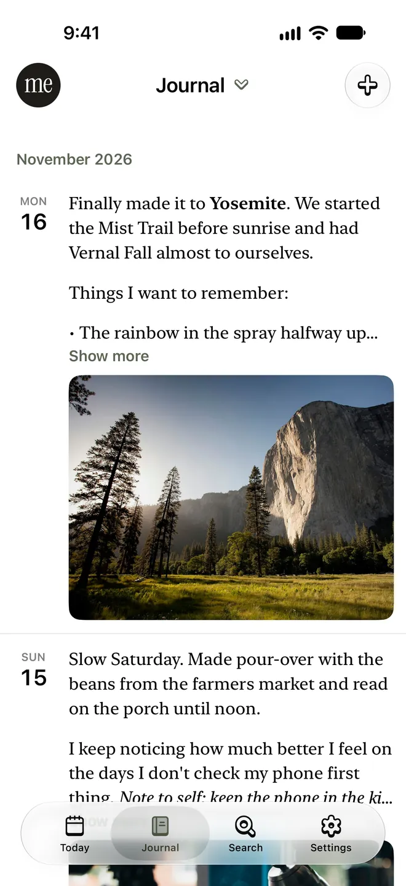
  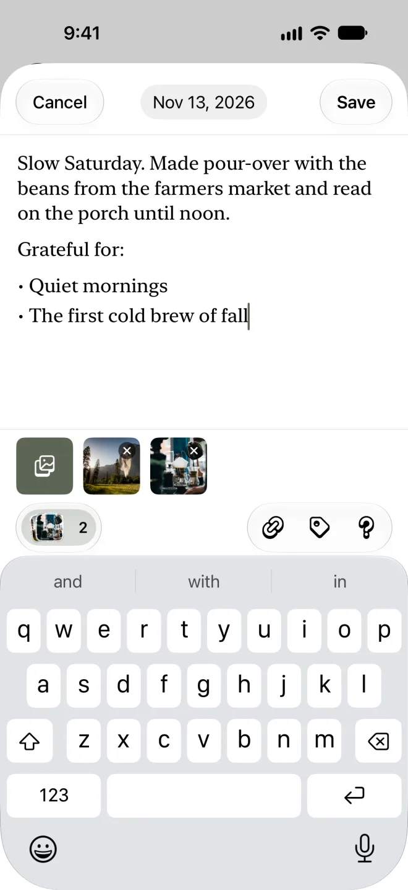
  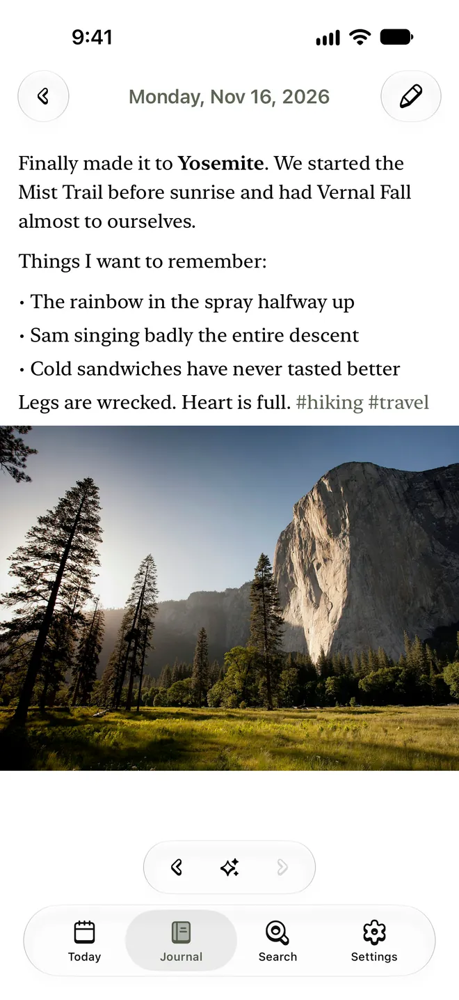
</p>
<p align="center">
  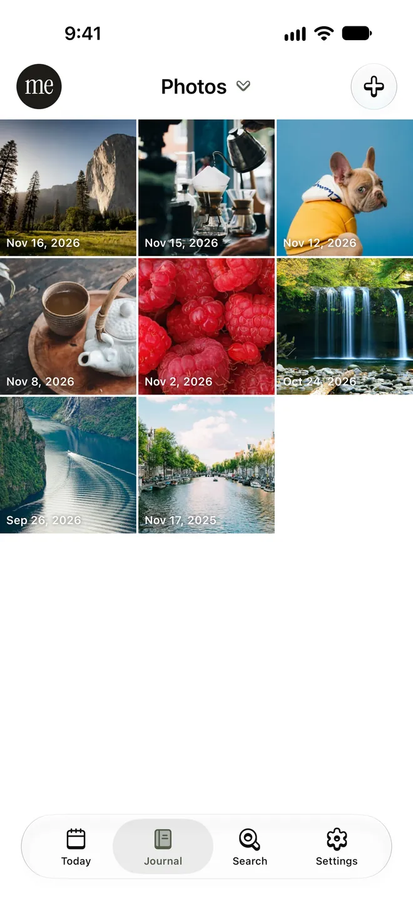
  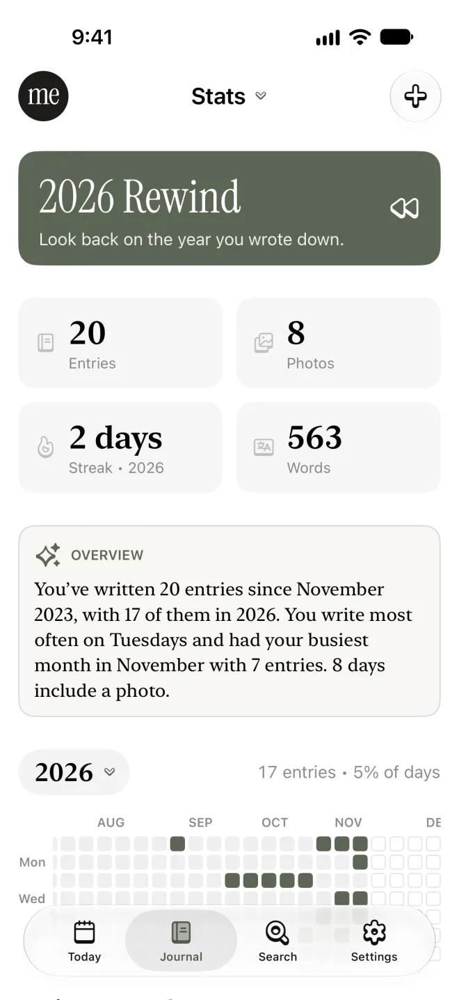
  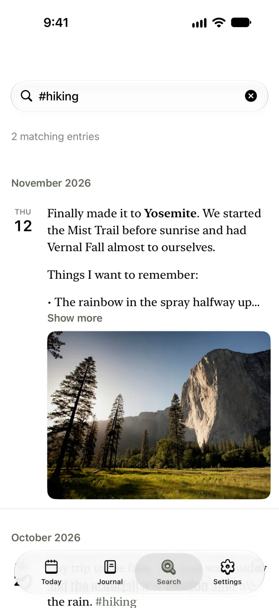
</p>

<sub>Every screenshot is from a made-up demo journal, never a real one.</sub>

## Get started

<table>
  <tr>
    <td width="33%" valign="top">
      <h3>✉️ Journal by email</h3>
      Sign up, pick your days, and reply to the first email. That's it.<br><br>
      <a href="https://dabble.me/users/sign_up?utm_source=github&utm_medium=readme&utm_campaign=cta_cards"><strong>Create a free account →</strong></a>
    </td>
    <td width="33%" valign="top">
      <h3>📱 iPhone &amp; iPad</h3>
      Today's prompt, On This Day, photos, a widget and a Face ID lock. The app is in public beta on TestFlight.<br><br>
      <a href="https://testflight.apple.com/join/mYj4vrFZ"><strong>Join the beta →</strong></a><br>
      <a href="https://dabble.me/journal-app?utm_source=github&utm_medium=readme&utm_campaign=cta_cards">See the app tour</a>
    </td>
    <td width="33%" valign="top">
      <h3>📓 Coming from somewhere else?</h3>
      Keep your history and pick up where you left off.<br><br>
      <a href="https://dabble.me/ohlife-alternative?utm_source=github&utm_medium=readme&utm_campaign=cta_cards">Coming from OhLife</a><br>
      <a href="https://dabble.me/day-one-alternative?utm_source=github&utm_medium=readme&utm_campaign=cta_cards">Coming from Day One</a><br>
      <a href="https://dabble.me/how-to-start-journaling?utm_source=github&utm_medium=readme&utm_campaign=cta_cards">New to journaling? Start here</a>
    </td>
  </tr>
</table>

## Pricing

Start free. Upgrade when it feels right.

| | **Free** | **PRO** |
|---|---|---|
| **Price** | $0, forever | **$4/month or $40/year** |
| Email prompts | Every other Sunday | Any days and time you choose |
| Write by replying to the email | ✓ | ✓ |
| Write in the iPhone &amp; iPad app | ✓ text entries | ✓ with photos, links and editing |
| Write and edit on the website | | ✓ |
| Read your journal online | ✓ | ✓ |
| A past entry in your email | ✓ | ✓ |
| Export everything (TXT or JSON) | ✓ | ✓ |
| Photos (up to 8 per entry) | | ✓ |
| Search, calendar and #hashtags | | ✓ |
| On This Day and your year in review | | ✓ |
| Writing stats by year | | ✓ |
| Import from OhLife, Day One, Ahhlife, Trailmix | | ✓ |
| Spotify songs in entries | | ✓ |
| AI connector for Claude and ChatGPT | | ✓ |

<p align="center">
  <a href="https://dabble.me/users/sign_up?utm_source=github&utm_medium=readme&utm_campaign=cta_pricing"><strong>Start free →</strong></a>
  &nbsp;&nbsp;·&nbsp;&nbsp;
  <a href="https://dabble.me/subscribe?utm_source=github&utm_medium=readme&utm_campaign=cta_pricing"><strong>Upgrade to PRO →</strong></a>
</p>

Subscribe on [dabble.me/subscribe](https://dabble.me/subscribe?utm_source=github&utm_medium=readme&utm_campaign=pricing_text), and the app unlocks PRO when you sign in. Free accounts get the app's on-device Apple Intelligence reflections, prompts and hashtag suggestions too.

---

## Self-hosting and development

Dabble Me is open source under the [MIT license](LICENSE). The hosted version at [dabble.me](https://dabble.me) is the easiest way to use it. If you'd rather run your own, everything below is for you.

It's a Rails 8.1 app (Ruby 4.0, PostgreSQL, Redis, Sidekiq, Puma). [`AGENTS.md`](AGENTS.md) has step-by-step setup for a fresh machine, and [`ios/README.md`](ios/README.md) covers the iPhone and iPad app.

### Third-party services

* [Cloudflare](https://cloudflare.com) managed DNS + free SSL support (free for basic service)
* [Mailgun](https://www.mailgun.com) for sending and receiving email (free for 50k emails per month)
* [Amazon S3](https://aws.amazon.com) for photo uploads and storage (free for 1 year)
* [Google Analytics](https://google.com/analytics) for traffic stats (free for standard analytics)
* [Turnstile](https://www.cloudflare.com/products/turnstile/) to prevent bot signups (free)
* [Sentry](https://www.sentry.io/) to report errors (free)

You will need to set up Mailgun to receive incoming emails and point them to your app to parse.

Scheduled jobs (including hourly email sending) are run by [sidekiq-cron](https://github.com/sidekiq-cron/sidekiq-cron) inside the Sidekiq worker process. The schedule lives in `config/schedule.yml`. No external scheduler is required.

### Environment variables

Local secrets live in a `.env` file at the repo root. [`dotenv-rails`](https://github.com/bkeepers/dotenv) loads it in development and test and does not override variables already set in the shell or in CI. Production on Railway uses the same variable names from the host environment. There is no `.env` file on Railway. `rake db:seed` creates the admin@dabble.ex account.

[1Password Environments](https://www.1password.dev/environments/local-env-file) can mount that path so the secrets are not stored as plaintext. `.1password/environments.toml` tells the 1Password Cursor hook to validate the mount.

1. In the 1Password app, open Developer, then Environments, and create an environment. Import this repo's `.env`, or add the names from `.env.example`.
2. Delete the plaintext `.env` after the import so 1Password can mount in its place.
3. Under Connect to, choose Local .env file, select this repo's `.env`, and mount it.
4. Keep 1Password unlocked while you boot Rails. The first read of `.env` asks you to authorize.

Variable names are listed in `.env.example`. A short version:

```dotenv
MAIN_DOMAIN=yourdomain.com
SECRET_KEY_BASE=1234..1234
DEVISE_SECRET_KEY=1234..1234
SMTP_DOMAIN=post.yourdomain.com
MAILGUN_API_KEY=api-key
TURNSTILE_SITE_KEY=6Lc6BAAAAAAAAChqRbQZcn_yyyyyyyyyyyyyyyyy
TURNSTILE_SECRET_KEY=6Lc6BAAAAAAAAKN3DRm6VA_xxxxxxxxxxxxxxxxx
GOOGLE_ANALYTICS_4_ID=UA-12345-67
SENTRY_DSN=https://dsn.sentry.io/1234
ANTHROPIC_API_KEY=sk-ant-1234
REFLECTION_MODEL=claude-opus-5-5
STRIPE_API_KEY=sk_test_1234
STRIPE_SIGNING_SECRET=whsec_1234
```

### JavaScript packages

Tailwind CSS is installed with npm. `package-lock.json` is the lockfile that belongs in git. Install with `npm install`. Continuous integration runs `npm ci`. Do not commit Yarn output: `yarn.lock`, `.pnp.cjs`, `.pnp.loader.mjs`, or `.yarn`.

### Things you may want to rip out

You can opt to not use Turnstile: simply don't add an environment variable for `TURNSTILE_SITE_KEY`.

### Tests

There is healthy coverage of the app, which you can run with:

```
rake
```

### Administration portal

The Admin emails are accounts that have access to the Admin Dropdown in the navbar (lock icon) that give you details into the number of entries and users in the system.

### Inspirations and importers

If you want random bits of inspiration, you can load up different quotes in the Inspiration table to be shown above the New Posts page and at the bottom of emails. Import sources are tagged via Inspiration categories — seed OhLife / Ahhlife / Day One / Trailmix rows (see `db/seeds.rb`), or the Day One importer will create its category on first use.

```ruby
Inspiration.create(category: 'OhLife', body: 'Imported from OhLife')
Inspiration.create(category: 'Day One', body: 'Imported from Day One')
```

PRO users can import from OhLife (text + photo ZIP), Day One (JSON ZIP export), Ahhlife (JSON paste), and Trailmix.life (JSON upload) at `/entries/import`.

### MCP (Model Context Protocol)

PRO accounts can use Dabble Me as a **remote MCP server** so compatible clients (for example Claude) can search, list, analyze, and create journal entries after OAuth.

**Requirements:** PRO subscription. Users get an email when a new OAuth app connects, and connected apps can be reviewed and revoked on Account security (`/security`) under **Connected apps**.

**Endpoint:** Streamable HTTP at `https://<MAIN_DOMAIN>/mcp` (see `MAIN_DOMAIN` in `.env`). The client should use OAuth: authorization metadata is published under `/.well-known/oauth-authorization-server` and `/.well-known/oauth-protected-resource` (see `Oauth::MetadataController`).

**User-facing instructions:** the AI Connector guide at `/mcp-server` on your host. Endpoint, OAuth, agent steps and the tool reference are at `/mcp-server/developers`.

**Deep links for assistants:** a single day opens at `https://<MAIN_DOMAIN>/entries/YYYY/M/D` with **unpadded** month and day (example: `https://dabble.me/entries/2026/4/21`). The web compose URL is `https://<MAIN_DOMAIN>/write`.

For generic remote-connector setup in Claude, see Anthropic’s [Get started with custom connectors using remote MCP](https://support.claude.com/en/articles/11175166-get-started-with-custom-connectors-using-remote-mcp).

**Registry metadata:** `server.json` describes the hosted Streamable HTTP endpoint for the official MCP Registry.

**WebMCP / AI-client discovery:** public pages advertise `/.well-known/webmcp`, `/mcp/server-card`, and `/.well-known/ai-catalog.json`. In a signed-in browser tab, WebMCP also registers session journal tools (search, list, analyze, open a day, draft an entry without submitting). Search/analyze/draft need PRO. Remote MCP at `/mcp` still uses OAuth (PRO). For the WebMCP Challenge, put a dedicated PRO demo account (email/password, no 2FA) on the submission form — do not use a real journal.

**Automated smoke (curl + [MCP Inspector](https://modelcontextprotocol.io/docs/tools/inspector) CLI):** `./script/mcp_inspector_smoke.sh` uses `RAILS_ENV=test`, starts a short-lived Rails server, checks OAuth metadata and `/mcp`, then runs Inspector against all five tools (`tools/list` exercises `initialize` + connect). Aligns with Anthropic’s [Testing your connector](https://claude.com/docs/connectors/build/testing) guidance.

### Screenshots in this README

`docs/readme/` holds the web screenshots, taken from a local run with the seeded demo account (`bundle exec rails ios:demo_account`); the iPhone ones come from `app/assets/images/ios-app/`, which are the App Store screenshots (see `ios/AppStore/metadata.md`). Never use a real journal for either.
